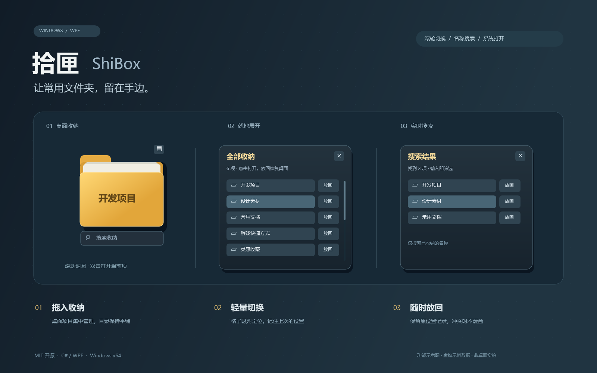

# 拾匣 · ShiBox

一个轻量的 Windows 桌面收纳组件：把常用文件夹和快捷方式收进黄色文件夹，滚动切换，双击用系统默认应用打开。



*按当前界面绘制的功能示意图，使用虚构示例数据，不包含私人桌面内容。*

> **试用版 / Experimental**：这是独立的 C# / WPF 透明窗口程序，不是 Windows Explorer 原生图标、系统 Shell 扩展或 Wallpaper Engine 壁纸。请先用可恢复的普通文件试用。

## 功能

- 黄色文件夹外观，封皮显示当前项目名称。
- 拖入桌面项目收纳；鼠标滚轮翻阅，双击打开当前项目。
- 文件夹由 Windows 文件资源管理器打开，文件和快捷方式由默认应用打开。
- 右上角展开全部收纳；搜索框实时按名称模糊匹配（字符顺序匹配，不是拼音或全文搜索）。
- 深色二级面板、圆角细滚动条。
- 按系统图标间距吸附，保存位置和当前选择。
- 单实例运行；支持记录恢复和放回原桌面位置。

## 文件到底放在哪里？

**从桌面直接拖入会移动真实文件，其他目录拖入仅添加引用。**

默认收纳目录为：

```text
%USERPROFILE%\拾匣收纳\你拖入的文件夹
```

目录平铺，不使用随机编号或 `content` 中间层。同名项目自动添加数字后缀，不覆盖已有内容。

配置与恢复凭据保存在：

```text
%LOCALAPPDATA%\ShiBox\layout.json
%LOCALAPPDATA%\ShiBox\receipts\
```

- 展开列表里的 **放回**：恢复托管项目到原桌面位置，并移出收纳。
- **移出**：仅移除引用，原文件不受影响。
- 同名恢复冲突会拒绝覆盖。
- 退出程序或关闭电脑不会主动删除收纳文件。
- **删除程序前，请先放回文件或备份收纳目录和配置。不要把收纳目录当缓存删除。**
- 当前基于同卷移动实现。桌面与用户目录分属不同盘符时，移动可能失败并显示错误；不要据此删除原件。
- 收纳包含项目源码、工具或相对路径引用的目录可能影响外部入口，使用前自行保留备份。

## 构建与运行

需要 Windows x64、.NET 9 SDK。框架依赖包运行时需要 .NET 9 Windows Desktop Runtime。

在仓库根目录运行 PowerShell：

```powershell
dotnet build .\src\ShiBox\ShiBox.csproj -c Release
dotnet publish .\src\ShiBox\ShiBox.csproj -c Release -r win-x64 --self-contained false -o .\artifacts\win-x64
.\artifacts\win-x64\ShiBox.exe
```

如果要发布包含运行环境的独立包，把 `--self-contained false` 改为 `--self-contained true`。分享整个输出目录，不要只复制 exe。

程序默认不出现在任务栏；右键黄色文件夹可以退出。传入 `--review` 可在任务栏显示，方便调试。

### 可选：登录后自启动

项目不会在运行时擅自写入自启动。需要时，在当前用户的启动目录创建快捷方式：

```powershell
$programPath = (Resolve-Path .\artifacts\win-x64\ShiBox.exe).Path
$startupPath = Join-Path ([Environment]::GetFolderPath('Startup')) 'ShiBox.lnk'
$shortcut = (New-Object -ComObject WScript.Shell).CreateShortcut($startupPath)
$shortcut.TargetPath = $programPath
$shortcut.WorkingDirectory = Split-Path $programPath
$shortcut.Save()
```

移除该启动快捷方式即可取消自启动，不影响收纳文件。请将程序放在固定目录后再配置。

## 存储检查

检查仅在指定目录创建测试数据，不读取或移动真实桌面项目：

```powershell
New-Item -ItemType Directory -Force .\artifacts\storage-check | Out-Null
dotnet .\src\ShiBox\bin\Release\net9.0-windows\ShiBox.dll --storage-check ((Resolve-Path .\artifacts\storage-check).Path)
Get-Content .\artifacts\storage-check\result.json
```

覆盖文件及文件夹收纳与恢复、恢复冲突保护、记录恢复、平铺路径和迁移后恢复。测试目录保留用于检查。

## 当前限制

- 在开发者本机验证了运行、原生打开、搜索和程序重启后恢复；没有全面的 Windows 版本或设备矩阵验证。
- 主屏工作区吸附，不自动避让已有桌面图标；不是 Explorer 原生图标排列。
- 多显示器、不同 DPI、虚拟桌面、Win+D、睡眠唤醒、资源管理器重启尚未充分验证。
- 自启动不等于已经验收完整关机重启场景。
- 托管项目手动改名、移动或改变恢复目录后，记录不会自动跟踪所有变化。
- 自定义透明窗口和弹出面板仍可能有边缘位置或焦点问题。
- 无后台升级、账号、云同步或遥测；源码不需要 API Key。

## 源码

- `src/ShiBox/Program.cs`：桌面窗口、交互、布局、搜索和打开入口。
- `src/ShiBox/CollectionStorage.cs`：平铺收纳、恢复凭据和冲突保护。
- `src/ShiBox/ScrollTheme.xaml`：深色滚动条样式。
- `src/ShiBox/StorageCheck.cs`：隔离存储检查。

仓库不包含个人收纳数据、迁移脚本、开发者配置、运行缓存或本机测试产物。

## 生成说明配图

配图绘制源码随仓库提供，无需图片服务或 API Key。在 Windows 上运行：

```powershell
dotnet run --project .\tools\PreviewArt\PreviewArt.csproj -c Release -- .\docs\images\shibox-preview.png
```

## License

[MIT](LICENSE)。欢迎使用、修改和提交问题。提交问题时不要附上私人文件内容或完整个人路径。
